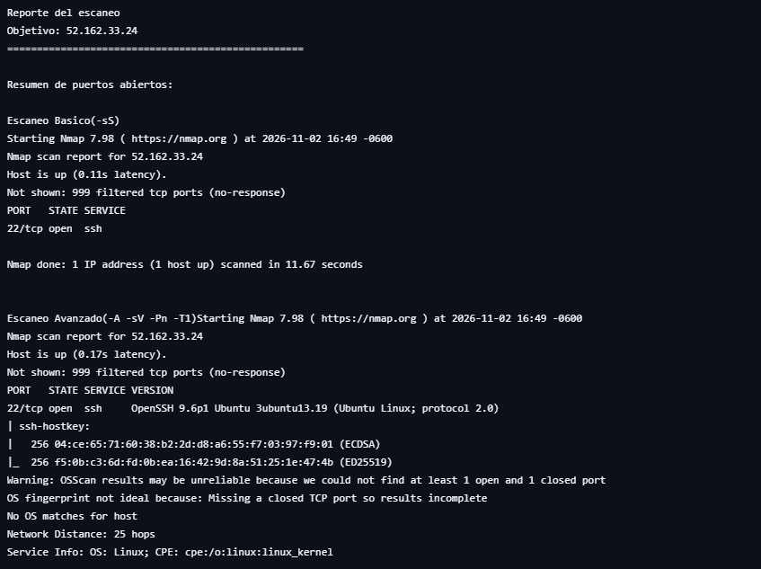
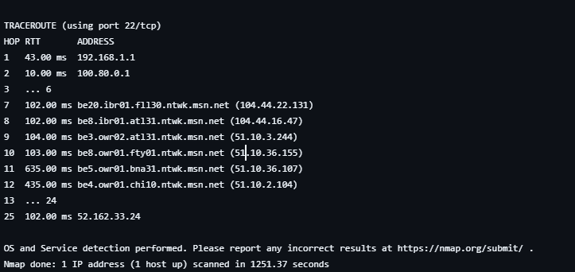

1. Objetivo del ataque

En este informe se van a documentar las actividades realizadas por el equipo de Red Team 
como parte del proyecto de Ciberseguridad del curso de programacion avanzada: 
El objetivo principal fue evaluar el nivel de exposición y seguridad de la máquina virtual asignada al equipo de Blue Team, desplegada en Microsoft Azure, mediante técnicas controladas de reconocimiento, análisis de tráfico e intentos de acceso no autorizado.

La máquina objetivo corresponde a una VM Ubuntu Linux ubicada en la dirección IP Publica 
52.162.33.24.

2. Metodología empleada

Para el desarrollo del ataque seguimos una metodología estructurada en tres fases: reconocimiento, análisis de tráfico e intento de acceso.

Fase 1 - Reconocimiento (scanner.py): Se desarrolló un script en Python que 
automatiza el uso de Nmap mediante el módulo subprocess, con el fin de identificar 
los puertos abiertos y servicios activos en la VM objetivo. Se ejecutaron dos tipos 
de escaneo: uno SYN básico (-sS) para una identificación rápida de puertos, y uno 
avanzado (-A -sV -Pn -T1) para obtener versiones de servicios, detección de sistema 
operativo y un perfil más detallado del objetivo, priorizando el sigilo mediante 
temporización lenta (-T1). El script genera automáticamente un reporte en texto con 
el resumen de puertos abiertos encontrados.

Fase 2 - Análisis de tráfico (packet_attack.py): Utilizando la librería Scapy, se 
capturó y analizó el tráfico de red relacionado con la VM objetivo, con el propósito 
de identificar protocolos en uso, patrones de comunicación y posibles vectores de 
ataque adicionales.

Fase 3 - Intento de acceso (ssh_brute.py): Se desarrolló un script basado en la 
librería paramiko para realizar un ataque de diccionario contra el servicio SSH de 
la VM objetivo, con el fin de evaluar la robustez de las credenciales configuradas 
y la existencia de políticas de bloqueo ante múltiples intentos fallidos.

Cada una de estas fases fue documentada mediante capturas de pantalla y registros 
de salida, los cuales se incluyen como evidencia en la sección correspondiente de 
este informe.

3. Resultados

3.1 Escaneo de puertos (scanner.py)

Se ejecutaron ambos escaneos (básico y avanzado) contra la IP 52.162.33.24. El 
escaneo básico (-sS) completó en 11.67 segundos, mientras que el escaneo avanzado 
(-A -sV -Pn -T1), debido a su temporización sigilosa, tardó aproximadamente 1251 
segundos (cerca de 21 minutos).

Resultado: se identificó únicamente el puerto 22/tcp abierto, correspondiente al servicio SSH, ejecutando OpenSSH 9.6p1 sobre Ubuntu Linux (protocolo 2.0). Los 999 puertos restantes analizados se reportaron como filtrados (no-response), lo cual indica la presencia de un firewall o Network Security Group (NSG) configurado por el equipo de Blue Team, limitando significativamente la superficie de ataque 
expuesta.

Debido a la falta de puertos cerrados detectables, Nmap no logró determinar concerteza el sistema operativo mediante fingerprinting (OS fingerprint not ideal), aunque la información del servicio SSH confirmó que se trata de un sistema Linux basado en el kernel de Linux (CPE: cpe:/o:linux:linux_kernel).

3.3 Análisis de tráfico y paquetes (packet_attack.py)

Se desarrolló un script en Python utilizando Scapy para capturar y analizar tráfico de red relacionado con la VM objetivo, así como para generar paquetes SYN de prueba de forma manual.

Al enviar un paquete SYN dirigido al puerto 22/tcp de la VM objetivo, se confirmó una respuesta activa del servicio SSH. Posteriormente, se capturó el tráfico generado durante un intento de conexión SSH hacia la VM, registrando el intercambio de paquetes TCP entre la máquina atacante y el puerto SSH del objetivo (52.162.33.24).

Adicionalmente, se intentó generar tráfico ICMP (ping) hacia la VM objetivo con fines de prueba, confirmándose que dicho tráfico es bloqueado por el Network Security Group (NSG) de Azure configurado por el equipo de Blue Team, coincidiendo con el comportamiento ya observado durante la fase de escaneo.

Toda la captura fue almacenada en los archivos captura_trafico.pcap (formato estándar compatible con Wireshark) y evidencia_trafico.txt (resumen en texto plano de cada paquete analizado).

3.3 Intento de acceso por fuerza bruta (ssh_brute.py)

Se desarrolló un script en Python utilizando la librería paramiko para intentar autenticación SSH contra el usuario BlueTeam en la VM objetivo (52.162.33.24), probando un diccionario de 4 contraseñas, incluyendo contraseñas comunes (123456, admin, clave123) y una contraseña de referencia de mayor complejidad (UnaClaveLarga-2026!).

Resultado: ninguno de los 4 intentos logró acceso exitoso. Los registros generados 
muestran que las 4 pruebas se completaron en un lapso de apenas 2 segundos, un tiempo de respuesta muy rápido que sugiere que la VM podría tener deshabilitada la autenticación por contraseña, aceptando únicamente 
acceso mediante llave SSH. Todos los intentos quedaron registrados automáticamente en el archivo intentos_ssh.log, generado por el propio script como evidencia del proceso.

Este resultado indica una postura de seguridad adecuada por parte del equipo de 
Blue Team frente a ataques de diccionario básicos.

4. Evidencias
Scanner.py

ssh_brute

5. Reflexión sobre la eficacia del Blue Team

Con base en los resultados obtenidos durante las tres fases del ataque, se observa que el equipo de Blue Team implementó medidas de seguridad efectivas en la VM objetivo. La superficie de ataque expuesta fue mínima, limitándose únicamente al puerto 22/tcp (SSH), mientras que el resto de los puertos analizados se mantuvo filtrado, reflejando una configuración de firewall o Network Security Group (NSG) bien restringida.

El bloqueo del tráfico ICMP (ping) también evidencia una postura defensiva consciente, ya que reduce la capacidad del atacante para realizar un reconocimiento básico de disponibilidad del host.

En cuanto al acceso por fuerza bruta, ninguno de los intentos realizados con el diccionario de contraseñas logró autenticarse exitosamente. El tiempo de respuesta extremadamente rápido ante cada intento sugiere que la VM podría tener deshabilitada la autenticación por contraseña, permitiendo acceso únicamente mediante llave SSH, lo cual representa una práctica de seguridad recomendada frente a este tipo de ataques.

En general, el equipo de Blue Team demostró un nivel adecuado de hardening sobre la VM asignada, dificultando significativamente las posibilidades de acceso no autorizado por parte del Red Team durante esta fase del proyecto.

6. Recomendaciones de mejora

A pesar de los resultados favorables para la defensa, se identifican algunas recomendaciones que podrían reforzar aún más la seguridad de la VM:

Implementar un sistema de detección de intentos de autenticación fallidos (por ejemplo, Fail2Ban), que permita bloquear automáticamente direcciones IP con múltiples intentos de acceso SSH fallidos, incluso si la autenticación por contraseña ya se encuentra deshabilitada.

Restringir el acceso al puerto 22 únicamente a direcciones IP específicas y conocidas (por ejemplo, las del equipo de administración), en lugar de mantenerlo abierto a cualquier origen, reduciendo aún más la superficie de ataque expuesta.

Habilitar registros (logs) de los intentos de conexión SSH y revisarlos de forma periódica, para identificar patrones de actividad sospechosa de forma proactiva.

Evaluar el uso de Azure Monitor o alertas automáticas ante actividad de red inusual, como múltiples intentos de conexión en un periodo corto de tiempo, lo cual permitiría una respuesta más rápida ante ataques reales.
